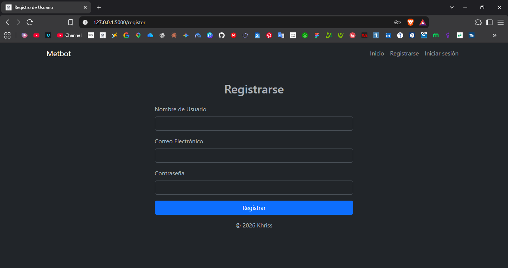
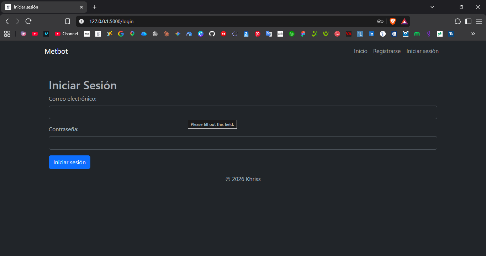

# 💬 botflask

> Mini red social construida con **Python + Flask**: publica en un feed común, reacciona y chatea en tiempo real. Proyecto de portafolio con arquitectura modular, migraciones, pruebas automatizadas y seguridad básica en el backend.


---

## 🎬 Demo

- 🌐 [Probar la app en vivo](https://TU-APP.onrender.com)
- 📹 [Ver demo en video](https://youtu.be/XXXXXXXXXXX)

> La app está en un plan gratuito de Render: si estuvo inactiva, la primera carga puede tardar un poco.

---

## 📸 Capturas de Pantalla
| Feed y reacciones | Chat en tiempo real |
| :---: | :---: |
|  |  |
|  |  |
|  |  |

---

## ¿Qué hace esta app?

Los usuarios pueden registrarse, iniciar sesión, publicar en un feed compartido y reaccionar a las publicaciones con seis tipos de reacción. También pueden chatear uno a uno en tiempo real con otros usuarios, con el historial guardado en la base de datos, y editar su perfil.

Los administradores cuentan además con un panel para gestionar usuarios (editar y eliminar). Al eliminar un usuario se borra en cascada todo lo que creó: publicaciones, reacciones y mensajes.

Es un proyecto personal de práctica: el objetivo es demostrar un backend completo con Flask, no resolver un problema comercial.

---

## Stack técnico

| Capa | Tecnología |
|---|---|
| Backend | Python 3.14 · Flask · SQLAlchemy · Flask-Migrate (Alembic) |
| Tiempo real | Flask-SocketIO · Socket.IO 4 · simple-websocket |
| Autenticación | Flask-Login · hash de contraseñas con Werkzeug |
| Seguridad | Flask-WTF (CSRF) · validación de datos en el servidor |
| Base de datos | SQLite (local) · PostgreSQL (producción) |
| Frontend | Jinja2 · Bootstrap 5 · Font Awesome · JavaScript Vanilla (Fetch) · jQuery + DataTables en el panel de usuarios |
| Servidor | Gunicorn · Render |
| Pruebas | pytest |

---

## Decisiones técnicas destacadas

**Arquitectura modular.** Application factory (`create_app`) y un blueprint por funcionalidad (`auth`, `main`, `posts`, `users`, `chat`). Las extensiones viven en un módulo propio, sin imports circulares, y la configuración se lee de variables de entorno.

**Migraciones versionadas.** El esquema de la base de datos se gestiona con Flask-Migrate y Alembic. Un clon nuevo se levanta con `db upgrade`, sin crear tablas a mano.

**Seguridad:**
- Protección CSRF en todos los formularios y en las peticiones `fetch`/AJAX (cabecera `X-CSRFToken`)
- Cierre de sesión solo por `POST`, con token
- Contraseñas con hash y reglas de complejidad (mínimo 8 caracteres, mayúscula, minúscula y número)
- Validación y normalización de usuario y correo: sin duplicados, sin espacios ni nombres en blanco, correo en minúsculas
- Cookies de sesión con `SameSite=Lax`, y `Secure` en producción
- Los mensajes del chat se validan en el servidor (destinatario existente, no escribirse a uno mismo, longitud máxima) y se muestran con `textContent`, sin HTML inyectable
- Secretos fuera del repositorio (`.env`, ignorado por git)

**Chat en tiempo real.** Cada conversación entre dos usuarios usa una sala de Socket.IO propia, derivada de sus ids. El servidor emite errores al emisor cuando un mensaje se rechaza.

**Fechas en UTC.** Se guardan en UTC y se muestran en hora local mediante un filtro de Jinja.

**Comando para crear administradores.** `flask --app wsgi crear-admin` crea el usuario de forma interactiva o con variables de entorno, reutilizando las mismas validaciones que la web.

---

## Pruebas automatizadas

Hay una batería de pruebas con **pytest** que usa una base de datos en memoria y una configuración de pruebas aislada (no toca la base de datos real). Cubre:

- Carga de páginas y rutas protegidas
- Registro y login (casos correctos e incorrectos)
- Validación de datos: usuario o correo duplicado, nombre en blanco, correo inválido
- Reglas de contraseña
- Protección CSRF y cierre de sesión solo por `POST`
- Validaciones del chat
- Eliminación de usuarios en cascada

```bash
pip install -r requirements-dev.txt
python -m pytest
```

---

## Estructura del proyecto

```
botflask/
├── app/
│   ├── __init__.py        # create_app() — application factory
│   ├── config/            # Configuración por entorno (.env)
│   ├── extensions/        # db, migrate, login_manager, socketio, csrf
│   ├── models/            # User, Post, Reaction, Mensaje
│   ├── controllers/       # Un blueprint por funcionalidad
│   │   ├── auth.py        # registro, login, logout
│   │   ├── index.py       # inicio, errores 401/404, favicon
│   │   ├── post.py        # feed y reacciones
│   │   ├── users.py       # perfil y panel de administración
│   │   └── mensajes.py    # chat: API REST + eventos Socket.IO
│   ├── utils/             # Validadores
│   ├── templates/         # Plantillas Jinja2 y partials
│   ├── static/            # CSS, JS e imágenes
│   └── crear_admin.py     # Comando CLI para crear administradores
├── migrations/            # Migraciones de base de datos (Alembic)
├── tests/                 # Pruebas con pytest
├── docs/screenshots/      # Capturas y GIFs del README
├── wsgi.py                # Punto de entrada
├── requirements.txt
└── requirements-dev.txt
```

---

## Instalación local

```bash
# 1. Clonar el repositorio
git clone https://github.com/Khrisstopher/botflask.git
cd botflask

# 2. Crear y activar el entorno virtual
python -m venv venv
# Windows:      venv\Scripts\activate
# Linux/macOS:  source venv/bin/activate

# 3. Instalar dependencias
pip install -r requirements.txt

# 4. Configurar el entorno
cp .env.example .env          # en Windows: copy .env.example .env
python -c "import secrets; print(secrets.token_hex(32))"
# Pega el resultado como SECRET_KEY en el archivo .env

# 5. Crear la base de datos (SQLite en instance/botflask.db)
flask --app wsgi db upgrade

# 6. Crear el usuario administrador (pide usuario, correo y contraseña)
flask --app wsgi crear-admin

# 7. Ejecutar la app
python wsgi.py
```

Abre `http://localhost:5000` en el navegador.

### Variables de entorno

| Variable | Descripción |
|---|---|
| `SECRET_KEY` | Clave para firmar las sesiones (obligatoria en producción) |
| `DATABASE_URL` | URL de PostgreSQL. Si se omite, usa SQLite en `instance/` |
| `CORS_ORIGINS` | Orígenes permitidos para Socket.IO (opcional; por defecto, solo el mismo origen) |
| `SESSION_COOKIE_SECURE` | Poner `1` en producción (HTTPS) |
| `ADMIN_USERNAME`, `ADMIN_EMAIL`, `ADMIN_PASSWORD` | Opcionales: evitan las preguntas de `crear-admin` |

---

## Despliegue en Render

- **Build command:** `pip install -r requirements.txt`
- **Start command:** `flask --app wsgi db upgrade && gunicorn -w 1 --threads 100 wsgi:app`
- **Base de datos:** PostgreSQL de Render, conectada mediante `DATABASE_URL`
- **Variables:** `SECRET_KEY`, `DATABASE_URL`, `SESSION_COOKIE_SECURE=1`, `PYTHON_VERSION`

---

## Autor

**Cristofer Castro Arias**

[WhatsApp](https://wa.me/573005352422)

[YouTube](https://www.youtube.com/@KhrisstopherTube)

[Email](mailto:moralesk2026@outlook.com)

---